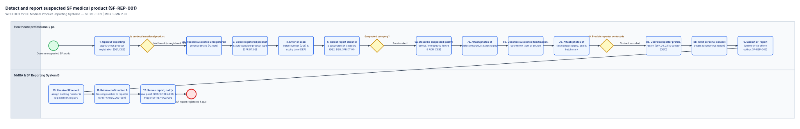

# Detect and report suspected SF medical product (SF-REP-001) — BPMN 2.0 Verification Checklist

- **Process ID:** `Process_SF_REP_001` (`SF-REP-001`)
- **L1 Source Sections:** `sec-023, sec-024, sec-025, sec-037` (PDF pages 39, 40, 41, 42, 43, 66, 67)
- **Swimlanes bound to DAK Personas / ArchiMate Roles:**
  - `Lane_SF_REP_001_HCP` → `pers:sfp-r-01` (`partitionElementRef="sfp-r-01"`) — Healthcare professional / patient / supplier reporter (SFP-R-01..SFP-R-12, SFP-R-14)
  - `Lane_SF_REP_001_NMRA` → `pers:sfp-r-13` (`partitionElementRef="sfp-r-13"`) — NMRA & SF Reporting System Back-End (SFP-R-13)

## Narrative Summary

End-to-end workflow for detecting and reporting a suspected substandard or falsified (SF) medical product, formalised from Table 10 (SF-REP-001 process matrix, p. 29 / PDF p. 41), Fig. 4 (workflow diagram, p. 30 / PDF p. 42), and Table 9 (9 user scenarios, pp. 27-28 / PDF pp. 39-40). Finding F5 corrections applied and recorded: (1) Fig. 4 step 2 duplicated gateway 1 ('Is the product registered?') — collapsed into task Task_CheckRegistration followed by exclusive gateway Gw_IsRegistered; (2) Fig. 4 gateway 1 had an unlabelled bypass arrow to the end event — replaced by explicit branch Task_FlagUnregistered documenting Finding F2 (unregistered/unlicensed products defined in glossary p. ix but omitted from DE8); (3) Fig. 4 gateway 5 was labelled as an imperative ('Select type of report') — separated into user task Task_SelectReportType and exclusive gateway Gw_ReportCategory ('Suspected category: Substandard or Falsified?'); (4) Fig. 4 repeated step numbers 6, 7, 8 on both branches — assigned distinct node IDs and labels on the substandard branch (6a-8a) and falsified branch (6b-8b) before converging at Gw_MergeSubmission; (5) all symbols conform to OMG BPMN 2.0 and Annex 3 (pp. 54-55 / PDF pp. 66-67).

> [!WARNING]
> **BPMN Redraw & Source Review Notes (`litlfred/dth-sfp#1` §3):**
> - F2: Report type in Fig. 4 (p. 30) omits 'unregistered/unlicensed medical products' (the third WHO SF category defined on p. ix and p. 1), offering only substandard and falsified branches.
> - F5: Fig. 4 (p. 30 / PDF p. 42) has 5 BPMN 2.0 defects: (1) step 2 repeats gateway 1 ('Is the product registered?'); (2) gateway 1 has an unlabelled bypass arrow to the end event; (3) gateway 5 is labelled 'Select type of report' (imperative task label) rather than a question; (4) step numbers 6, 7, 8 repeat on both parallel paths; (5) symbol usage violates Annex 3 rules. Redrawn cleanly in processes/SF-REP-001.bpmn while keeping Fig. 4 as the cited L1 figure.
