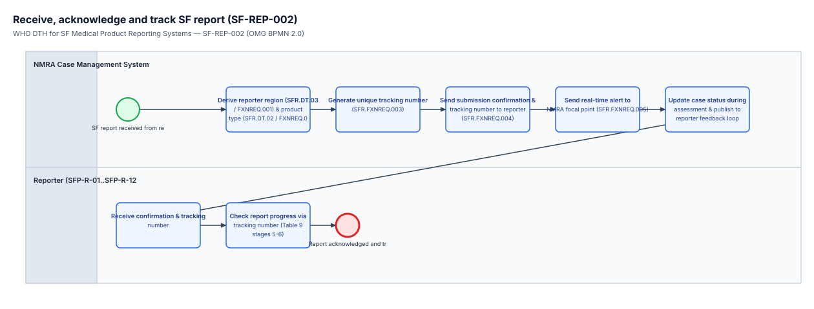

<!-- GENERATED from dth-sfp/processes/SF-REP-002.bpmn by cat-harness-tools/scripts/bpmn-checklist.ts. Do not edit: change the diagram and regenerate (bun run cat bpmn:checklist). -->

# Checklist — SF-REP-002: Screen, classify and acknowledge SF report

> **Generated, and not the authority.** This is `dth-sfp/processes/SF-REP-002.bpmn` (process `Process_SF_REP_002`) walked as a state machine. The diagram and the workflow engine decide; this list only reads them. Follow the `next:` line of each step rather than the order on the page, and record each step with the call it names, so the engine's committed state — not this list — says which edge was taken.

Workflow for NMRA automated routing, real-time focal point notification, completeness screening, and reporter progress tracking, formalised from Table 9 stages 5-6 (pages 27-28 / PDF pages 39-40) and Table 12 functional requirements SFR.FXNREQ.001, 003-006, and 010-012 (pages 31-32 / PDF pages 43-44

## Begin — Receive submitted SF report (`Start_SF_REP_002`)

- Begin here: Triggered upon receipt of a submitted SF report (from SF-REP-001 or SF-REP-006).
- Call `workflow_start` with `process: "Process_SF_REP_002"` and the subject this run is about; keep the instance id it returns.
- next: → `Task_201_AutoAssignRegion` (Derive region & product type (SFR.DT.02-03))

### 1. Derive region & product type (SFR.DT.02-03) (`Task_201_AutoAssignRegion`)

- Who: the `NMRA Reviewer & System (SFP-R-13)` lane (role `pers:sfp-r-13`).
- What: Automatically assign reporter geographic region (SFR.FXNREQ.001, SFR.DT.03) and populate registered product type (SFR.FXNREQ.006, SFR.DT.02).
- Record it: `workflow_complete` with `node: "Task_201_AutoAssignRegion"`.
- next: → `Task_202_AlertFocalPoint` (Send real-time alert to NMRA focal point)

### 2. Send real-time alert to NMRA focal point (`Task_202_AlertFocalPoint`)

- Who: the `NMRA Reviewer & System (SFP-R-13)` lane (role `pers:sfp-r-13`).
- What: Dispatch real-time notification to designated NMRA focal points upon report receipt (SFR.FXNREQ.005).
- Record it: `workflow_complete` with `node: "Task_202_AlertFocalPoint"`.
- next: → `Task_203_ScreenCompleteness` (Screen report completeness & triage priority)

### 3. Screen report completeness & triage priority (`Task_203_ScreenCompleteness`)

- Who: the `NMRA Reviewer & System (SFP-R-13)` lane (role `pers:sfp-r-13`).
- What: Review report fields (DE1-DE10), attached photos, and adverse reaction indicators to determine triage priority (SFR.FXNREQ.010).
- Record it: `workflow_complete` with `node: "Task_203_ScreenCompleteness"`.
- next: → `Task_204_ClassifyIncident` (Classify report path & link related cases)

### 4. Classify report path & link related cases (`Task_204_ClassifyIncident`)

- Who: the `NMRA Reviewer & System (SFP-R-13)` lane (role `pers:sfp-r-13`).
- What: Classify report workflow path (SFR.DT.01) and link reports sharing product name, batch number, or location (SFR.FXNREQ.011-012).
- Record it: `workflow_complete` with `node: "Task_204_ClassifyIncident"`.
- next: → `Task_205_UpdateCaseStatus` (Record triage decision & update status)

### 5. Record triage decision & update status (`Task_205_UpdateCaseStatus`)

- Who: the `NMRA Reviewer & System (SFP-R-13)` lane (role `pers:sfp-r-13`).
- What: Update case management status and publish status update to the reporter tracking interface (SFR.FXNREQ.004).
- Record it: `workflow_complete` with `node: "Task_205_UpdateCaseStatus"`.
- next: → `Task_206_ReceiveTrackingNumber` (Receive acknowledgement & tracking ID)

### 6. Receive acknowledgement & tracking ID (`Task_206_ReceiveTrackingNumber`)

- Who: the `Reporter (SFP-R-01..12, R-14)` lane (role `pers:sfp-r-01`).
- What: Receive confirmation message and unique tracking number (Table 9 stage 5, SFR.FXNREQ.003).
- Record it: `workflow_complete` with `node: "Task_206_ReceiveTrackingNumber"`.
- next: → `Task_207_TrackReportProgress` (Check report progress via tracking ID)

### 7. Check report progress via tracking ID (`Task_207_TrackReportProgress`)

- Who: the `Reporter (SFP-R-01..12, R-14)` lane (role `pers:sfp-r-01`).
- What: Query SF report status using the assigned tracking number (Table 9 stage 6, SFR.FXNREQ.004).
- Record it: `workflow_complete` with `node: "Task_207_TrackReportProgress"`.
- next: → `End_SF_REP_002` (Report triaged & acknowledged)

## Done — Report triaged & acknowledged (`End_SF_REP_002`)

- The instance completes here: SF report is screened, classified, and acknowledged. `workflow_next` then reports nothing enabled — that, not this line, is the record of completion.
