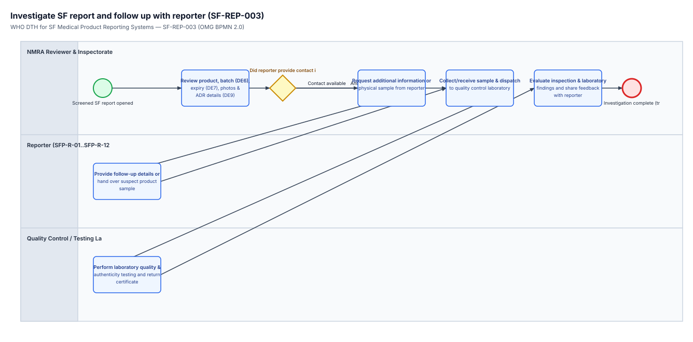

# Investigate SF report and follow up with reporter (SF-REP-003) — BPMN 2.0 Verification Checklist

- **Process ID:** `Process_SF_REP_003` (`SF-REP-003`)
- **L1 Source Sections:** `sec-004, sec-023, sec-024, sec-031` (PDF pages 13, 39, 40, 41, 59)
- **Swimlanes bound to DAK Personas / ArchiMate Roles:**
  - `Lane_SF_REP_003_NMRA` → `pers:sfp-r-13` (`partitionElementRef="sfp-r-13"`) — NMRA Reviewer & Inspectorate (SFP-R-13)
  - `Lane_SF_REP_003_Reporter` → `pers:sfp-r-01` (`partitionElementRef="sfp-r-01"`) — Reporter (SFP-R-01..SFP-R-12)
  - `Lane_SF_REP_003_Lab` → `pers:sfp-r-05` (`partitionElementRef="sfp-r-05"`) — Quality Control / Testing Laboratory (SFP-R-05)

## Narrative Summary

Workflow for regulatory investigation of a reported suspect medical product, reporter follow-up when contact details are available (DE10), and laboratory quality/authenticity testing, drafted from Introduction (p. 1 / PDF p. 13), Table 9 stage 6 (pp. 27-28 / PDF pp. 39-40), Table 10 (p. 29 / PDF p. 41), and Ch. 7 (p. 47 / PDF p. 59). Source gap note: pharmacovigilance co-routing rules when DE9 (adverse reaction) is populated and detailed laboratory analytical protocols are not specified in the handbook and are recorded as explicit open decision points.
