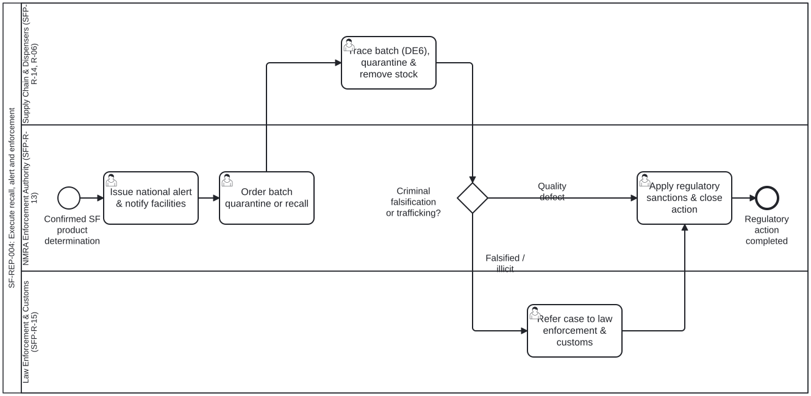

# Take regulatory action on confirmed SF product (SF-REP-004) — BPMN 2.0 Verification Checklist

- **Process ID:** `Process_SF_REP_004` (`SF-REP-004`)
- **L1 Source Sections:** `sec-004, sec-013, sec-014` (PDF pages 13, 27, 28)
- **Swimlanes bound to DAK Personas / ArchiMate Roles:**
  - `Lane_SF_REP_004_NMRA` → `pers:sfp-r-13` (`partitionElementRef="sfp-r-13"`) — NMRA Regulatory Enforcement Authority (SFP-R-13)
  - `Lane_SF_REP_004_SupplyChain` → `pers:sfp-r-14` (`partitionElementRef="sfp-r-14"`) — Supply Chain Actors, Manufacturers & Dispensers (SFP-R-14, SFP-R-06)
  - `Lane_SF_REP_004_LawEnforcement` → `pers:sfp-r-15` (`partitionElementRef="sfp-r-15"`) — Law Enforcement, Customs & Multisector Authorities (SFP-R-15)

## Narrative Summary

Workflow for regulatory response and enforcement when a medical product is confirmed as substandard, falsified, or unregistered: issuing alerts, quarantining and recalling affected batches across the supply chain (linked to dth-sc Recall capability id-a9c92f8fa2924d4180e8f5512b0d0097 and Traceability id-e88f6d077d31407bb1af5f2ecfd3b48a), applying regulatory sanctions, and referring criminal falsification cases to law enforcement and customs (Introduction p. 1, §2.1 p. 15, §2.2 p. 16).
