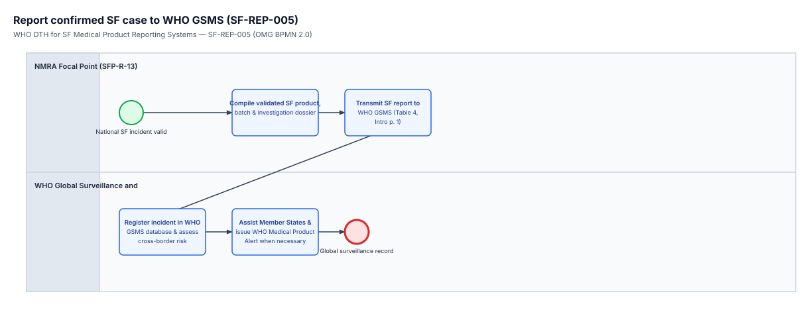

<!-- GENERATED from dth-sfp/processes/SF-REP-005.bpmn by cat-harness-tools/scripts/bpmn-checklist.ts. Do not edit: change the diagram and regenerate (bun run cat bpmn:checklist). -->

# Checklist — SF-REP-005: Report confirmed SF case to WHO GSMS

> **Generated, and not the authority.** This is `dth-sfp/processes/SF-REP-005.bpmn` (process `Process_SF_REP_005`) walked as a state machine. The diagram and the workflow engine decide; this list only reads them. Follow the `next:` line of each step rather than the order on the page, and record each step with the call it names, so the engine's committed state — not this list — says which edge was taken.

Workflow for national regulatory focal points to submit validated SF incident reports to the WHO Global Surveillance and Monitoring System (GSMS) and coordinate regional/global Medical Product Alerts (Introduction page 1 / PDF page 13; Table 4 page 12 / PDF page 24).

## Begin — Validated SF incident ready for GSMS (`Start_SF_REP_005`)

- Begin here: Triggered when a national SF incident is validated for global reporting to WHO GSMS.
- Call `workflow_start` with `process: "Process_SF_REP_005"` and the subject this run is about; keep the instance id it returns.
- next: → `Task_501_PrepareGSMSDossier` (Compile validated SF product & batch dossier)

### 1. Compile validated SF product & batch dossier (`Task_501_PrepareGSMSDossier`)

- Who: the `NMRA Focal Point (SFP-R-13)` lane (role `pers:sfp-r-13`).
- What: Prepare validated product, batch (DE6), manufacturer (DE4), and analytical dossier for global surveillance submission.
- Record it: `workflow_complete` with `node: "Task_501_PrepareGSMSDossier"`.
- next: → `Task_502_SubmitToGSMS` (Transmit SF report to WHO GSMS)

### 2. Transmit SF report to WHO GSMS (`Task_502_SubmitToGSMS`)

- Who: the `NMRA Focal Point (SFP-R-13)` lane (role `pers:sfp-r-13`).
- What: Transmit the structured SF report to the WHO Global Surveillance and Monitoring System (Table 4, Introduction page 1).
- Record it: `workflow_complete` with `node: "Task_502_SubmitToGSMS"`.
- next: → `Task_503_RecordInGSMS` (Register incident in GSMS & assess risk)

### 3. Register incident in GSMS & assess risk (`Task_503_RecordInGSMS`)

- Who: the `WHO Global Surveillance (GSMS) (SFP-R-15)` lane (role `pers:sfp-r-15`).
- What: Log the national SF report in the WHO GSMS global database and evaluate cross-border supply chain risk.
- Record it: `workflow_complete` with `node: "Task_503_RecordInGSMS"`.
- next: → `Task_504_IssueGlobalAlert` (Coordinate Member States & issue WHO alert)

### 4. Coordinate Member States & issue WHO alert (`Task_504_IssueGlobalAlert`)

- Who: the `WHO Global Surveillance (GSMS) (SFP-R-15)` lane (role `pers:sfp-r-15`).
- What: Support Member State investigations and publish a WHO Medical Product Alert when multi-country risk is identified.
- Record it: `workflow_complete` with `node: "Task_504_IssueGlobalAlert"`.
- next: → `End_SF_REP_005` (Global surveillance record updated)

## Done — Global surveillance record updated (`End_SF_REP_005`)

- The instance completes here: Global surveillance record updated in WHO GSMS. `workflow_next` then reports nothing enabled — that, not this line, is the record of completion.
