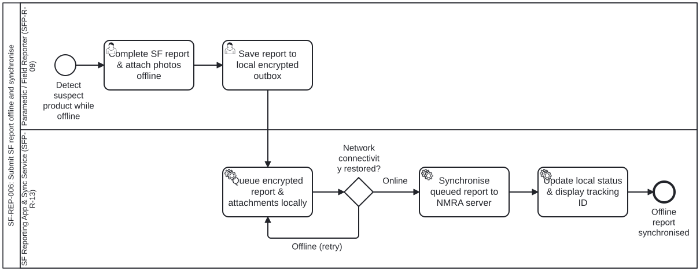

<!-- GENERATED from dth-sfp/processes/SF-REP-006.bpmn by cat-harness-tools/scripts/bpmn-checklist.ts. Do not edit: change the diagram and regenerate (bun run cat bpmn:checklist). -->

# Checklist — SF-REP-006: Submit SF report offline and synchronise

> **Generated, and not the authority.** This is `dth-sfp/processes/SF-REP-006.bpmn` (process `Process_SF_REP_006`) walked as a state machine. The diagram and the workflow engine decide; this list only reads them. Follow the `next:` line of each step rather than the order on the page, and record each step with the call it names, so the engine's committed state — not this list — says which edge was taken.

Subprocess of SF-REP-001 for capturing an SF report in low- or no-connectivity settings, queuing it in a local encrypted outbox, and synchronising automatically when connectivity is restored, drafted from Table 9 scenario 9 (Paramedic, page 28 / PDF page 40), Table 13 offline capability requirements

## Begin — Detect suspect product while offline (`Start_SF_REP_006`)

- Begin here: Field reporter detects a suspected SF product in an area without mobile or internet connectivity (Table 9 scenario 9).
- Call `workflow_start` with `process: "Process_SF_REP_006"` and the subject this run is about; keep the instance id it returns.
- next: → `Task_601_CompleteOfflineForm` (Complete SF report & attach photos offline)

### 1. Complete SF report & attach photos offline (`Task_601_CompleteOfflineForm`)

- Who: the `Paramedic / Field Reporter (SFP-R-09)` lane (role `pers:sfp-r-09`).
- What: Capture mandatory SF report fields (DE1-DE10) and product photographs in the offline-capable reporting app.
- Record it: `workflow_complete` with `node: "Task_601_CompleteOfflineForm"`.
- next: → `Task_602_SaveToOutbox` (Save report to local encrypted outbox)

### 2. Save report to local encrypted outbox (`Task_602_SaveToOutbox`)

- Who: the `Paramedic / Field Reporter (SFP-R-09)` lane (role `pers:sfp-r-09`).
- What: Save the completed report locally for automatic background transmission once connectivity returns.
- Record it: `workflow_complete` with `node: "Task_602_SaveToOutbox"`.
- next: → `Task_603_QueueEncryptedOutbox` (Queue encrypted report & attachments locally)

### 3. Queue encrypted report & attachments locally (`Task_603_QueueEncryptedOutbox`)

- Who: the `SF Reporting App & Sync Service (SFP-R-13)` lane (role `pers:sfp-r-13`).
- What: Store the SF report payload and attached photos in the encrypted local outbox queue (Table 13 security & offline NFRs).
- Record it: `workflow_complete` with `node: "Task_603_QueueEncryptedOutbox"`.
- next: → `Gw_601_NetworkAvailable` (Network connectivity restored?)

### Decide — Network connectivity restored? (`Gw_601_NetworkAvailable`)

- Check whether internet or mobile data connectivity is available to synchronise the queued report.
- Call `workflow_complete` with `node: "Gw_601_NetworkAvailable"` and `outcome` set to the label that holds:
  - «Online» → `Task_604_SyncToNMRAServer` (Synchronise queued report to NMRA server)
  - «Offline (retry)» → `Task_603_QueueEncryptedOutbox` (Queue encrypted report & attachments locally)

### 4. Synchronise queued report to NMRA server (`Task_604_SyncToNMRAServer`)

- Who: the `SF Reporting App & Sync Service (SFP-R-13)` lane (role `pers:sfp-r-13`).
- What: Upload the queued SF report and photos to the central NMRA reporting server and trigger SF-REP-002.
- Record it: `workflow_complete` with `node: "Task_604_SyncToNMRAServer"`.
- next: → `Task_605_DeliverConfirmation` (Update local status & display tracking ID)

### 5. Update local status & display tracking ID (`Task_605_DeliverConfirmation`)

- Who: the `SF Reporting App & Sync Service (SFP-R-13)` lane (role `pers:sfp-r-13`).
- What: Record server acknowledgement and display the assigned tracking number to the field reporter.
- Record it: `workflow_complete` with `node: "Task_605_DeliverConfirmation"`.
- next: → `End_SF_REP_006` (Offline report synchronised)

## Done — Offline report synchronised (`End_SF_REP_006`)

- The instance completes here: Queued offline report is synchronised and acknowledged. `workflow_next` then reports nothing enabled — that, not this line, is the record of completion.
